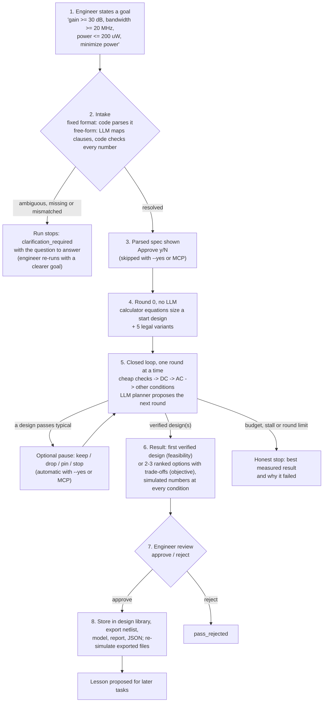
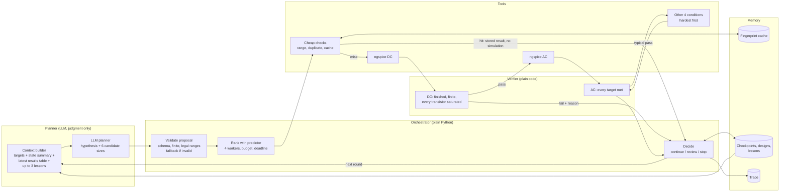
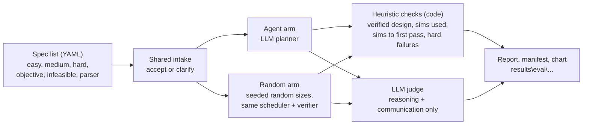
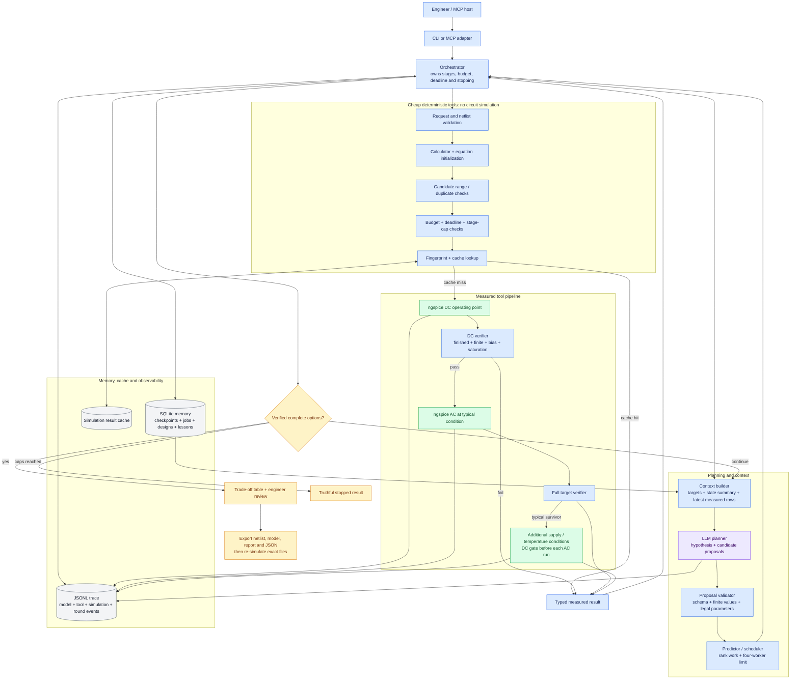
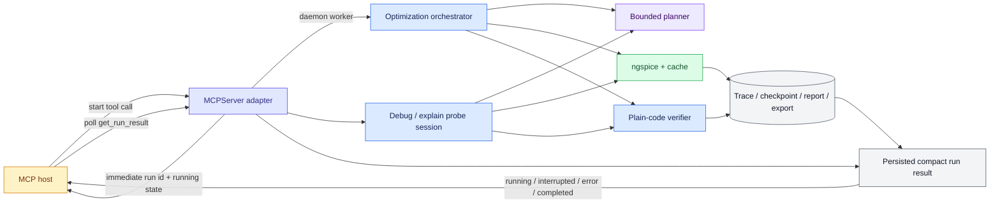
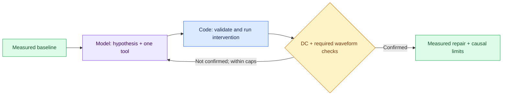
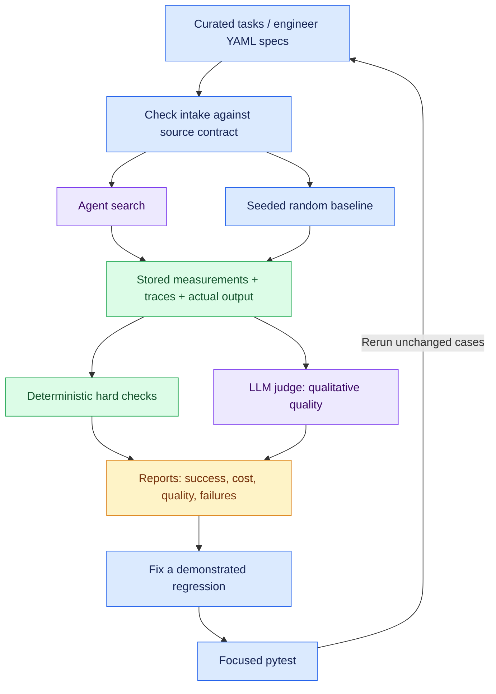
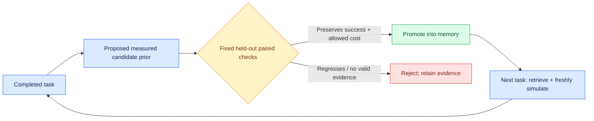

# Agent architecture

## At a glance

One Python orchestrator owns the run. One LLM gives judgment at a few bounded
points. Deterministic tools, ngspice and a plain-code verifier produce every
number and every pass/fail verdict.

| Part | What it is |
|---|---|
| LLM | Azure AI Foundry chat-completions deployment set by `LLM_MODEL` (evaluated with `gpt-6.1-sol`); JSON replies validated with Pydantic |
| LLM is used for | Free-form spec intake, planning later optimization rounds, choosing debug experiments, writing explanations, eval judging |
| LLM is never used for | Simulation, numbers, ranking candidates, pass/fail, budget, stopping, approval |
| Simulator | ngspice (batch mode), 180 nm PTM model file, netlist template with `{{ }}` placeholders at `circuits\ota5t.cir.j2` |
| Circuit | Five-transistor OTA; five supply/temperature conditions (typical 27 C / 1.8 V plus 1.62/1.98 V at -40/125 C) |
| Interfaces | CLI (`python -m agent.orchestrator`, `agent.debug_mode`, `agent.explain`) and MCP server for VS Code / Copilot |
| State | SQLite (checkpoints, jobs, cache, designs, lessons) and one JSONL trace per run |

### Tools the orchestrator calls

Every call is logged in the trace with inputs, outputs, timing and cache hits.

| Group | Tools (trace names) | Simulation cost |
|---|---|---|
| Intake | `interpret_request`, `read_request`, `select_structure` | none |
| Sizing | `calc`, `size_start`, `make_candidates` | none |
| Cheap checks | `quick_check` (range, duplicates), budget/deadline checks, fingerprint cache lookup | none |
| Context | `retrieve_lessons`, `retrieve_designs`, `build_context` | none |
| Ranking | `predict_candidate`, `prediction_error`, `select_survivors` | none |
| Simulation | `simulate` (DC operating point, then AC), `provenance` | paid |
| Verification | `verify_dc`, `verify`, `verified_options` | none |
| Engineer | `ask_pause`, `ask_engineer` | none |
| Delivery and memory | export (re-simulates the exported files), `write_proposed_lesson`, `write_failure_lesson` | paid on export |
| Debug / explain | `test_hypothesis`, `hypothesis_result`, `ground_explanation` | paid per probe |

## User journey: optimize



What the engineer sees, step by step:

1. **Goal.** One line of text, or `--task` from `tasks\specs.yaml`.
2. **Intake.** It does not chat. If any quantity, comparison or objective is
   unclear, the run ends immediately with outcome `clarification_required`
   and the exact question. Nothing is simulated. The engineer re-runs with a
   clearer goal.
3. **Confirm.** The parsed targets and assumptions are printed for approval.
4. **Planning starts without the LLM.** Round 0 comes from textbook equations
   via the calculator tool, so the first six candidates cost no model call.
5. **Closed loop.** Each round is filtered cheaply, simulated in parallel, and
   verified in code. From round 1 the LLM planner reads a compact results
   table and proposes the next six candidates. Default limits: 40
   simulations, 300 s, 20 rounds, stop after 3 rounds without improvement.
6. **Result.** For a feasibility goal the first design verified at all five
   conditions goes to review. For an objective (for example minimize power)
   the search continues, and verified designs are ranked in code and shown as
   options with their trade-offs.
7. **Review.** The engineer approves or rejects. `--yes` and MCP label this
   approval as automatic.
8. **Delivery.** Exported files are simulated again; delivery fails if they
   do not reproduce the result.

In VS Code (MCP), `optimize_circuit` returns a run id immediately and runs in
the background; `get_run_result` reports running, interrupted, error or the
final summary.

## The closed loop



The loop is closed through measured feedback only: the planner sees each
candidate's furthest stage and failure reason, never raw SPICE output. A
failed DC check stops a candidate before the more expensive AC run, and only
typical survivors are tried at the other four conditions. If a survivor fails,
the scheduler promotes the next deferred typical-pass candidate while budget
allows. Every result is checkpointed, so an interrupted run resumes.

## How evaluations run



Each arm gets a cold cache and the same budget. Heuristic checks decide
success; the judge cannot override them. `eval.run_eval` runs the fixed
regression suite, `eval.spec_list` runs an engineer-spec list, and
`eval.learning` runs the with/without-lessons ablation. Results and their
history are in `EVOLUTION.md`.

## Agent component architecture

The same system as one component map. Blue is deterministic Python, purple is
model judgment, green is ngspice measurement, gray is persistent state, amber
is review or delivery.



`agent\orchestrator.py` is the control plane. It does not give the model direct
access to ngspice, memory or arbitrary tools. Every model proposal returns to
the orchestrator, passes deterministic validation, follows the fixed simulation
stages, and becomes planner context only after measurement and verification.

## MCP adapter layer

`agent\mcp_server.py` exposes the existing production flows through the official
Python MCP SDK v2 over stdio. It is an interface layer, not another reasoning or
verification layer.



The tools are `optimize_circuit`, `debug_circuit`, `explain_circuit` and
`get_run_result`. Tool schemas are generated from Python types and Pydantic
constraints. Run identifiers are validated before path construction; only the
compact `mcp_summary.json` can be fetched through the result tool. Optimization
starts on a daemon worker and returns the run id immediately; `get_run_result`
reports running, interrupted, error or completed state. An identical interrupted
request can resume from its SQLite checkpoint. A completed run id is immutable:
an identical call returns its persisted summary, while changing its budget or
timeout is rejected with an instruction to use a new id. Diagnostics use
immutable fresh directories. MCP optimization is non-interactive and records
automatic approval explicitly; simulator budgets, deadlines, cache fingerprints,
grounding checks and deterministic verdicts are unchanged.

## Decision and authority boundaries

| Decision or output | Owner |
|---|---|
| Interpret a free-form specification | Model maps exact source clauses; code extracts quantities and validates the canonical request |
| Select topology | Code; only the five-transistor OTA is implemented |
| Initial sizes | Calculator-backed equations and explicit assumptions |
| Propose subsequent experiments | LLM planner, with a logged deterministic fallback |
| Choose diagnostic hypotheses and next tools | Bounded model loop; one validated intervention per experiment |
| Write circuit explanation | Model prose with measured-fact references; code rejects ungrounded numeric literals |
| Estimate candidate performance to prioritize work | Nearest-neighbor predictor |
| Choose work, enforce budget, advance stages and stop | Orchestrator |
| Produce engineering measurements | ngspice and deterministic calculation/parsing tools |
| Decide electrical pass/fail | Plain-code verifier |
| Rank verified options and compute numerical trade-offs | Plain code |
| Approve delivery | Engineer, or explicitly labeled `--yes` automation |
| Score qualitative output in evaluations | Separate LLM-judge call; cannot override hard checks |

## Layer: request and circuit intake

**Files:** `agent\spec.py`, `agent\intake.py`, `agent\reasoning.py`,
`agent\netlist.py`, `tasks\specs.yaml`.

```text
--spec text or --task preset
  -> preset / canonical syntax: deterministic parser
  -> free text: model selects exact source clauses and an objective
  -> code extracts source numbers, checks units, coverage and comparison direction
  -> parse the code-generated canonical specification
  -> identify supported objective
  -> disclose defaults; reject unsupported or ambiguous numeric constraints
  -> validate the optional netlist adapter
  -> typed Targets, objective, assumptions and circuit identity
```

Objectives are feasibility, minimize power, maximize gain and maximize bandwidth.
`--intake auto` uses the deterministic path when possible and otherwise the model.
`--intake deterministic` disables model intake; `--intake model` forces it.
Ambiguity produces clarification questions and no simulation. In interactive mode,
model-extracted targets are presented for approval; `--yes` explicitly skips approval,
but cannot bypass ambiguity or hard validation. Accepted extraction is checkpointed
and reused on resume, not regenerated by another model call.

Source binding prevents invented quantities, not every possible semantic
misinterpretation of natural language: engineer review remains important.
A supplied netlist must follow the supported OTA adapter; this is not arbitrary
circuit ingestion.

## Layer: initialization and reusable priors

**Files:** `agent\orchestrator.py` (`size_start`, `_load_or_start`),
`agent\tools.py`, `agent\memory.py`.

```text
Typed request
  -> check for a compatible checkpoint
  -> otherwise select the fixed OTA structure
  -> calculator-backed gm/current/W/L estimates using model parameters
  -> generate legal initial variants
  -> optionally include a held-out-validated candidate prior
  -> range-check and checkpoint the initial population
```

Estimates use explicit assumptions, such as load capacitance and overdrive.
They are starting proposals, not measured performance. A reusable prior is
freshly checked with DC and AC at every required condition before the rest of
the population; past success is not accepted as a current measurement.

## Layer: context and memory retrieval

**Files:** `agent\context.py`, `agent\orchestrator.py` (`_planner_state`),
`agent\tools.py` (`retrieve_designs`).

```text
Latest typed state + compatible memory
  -> targets, objective and assumptions
  -> budget, best result and compact earlier-round summaries
  -> latest-round result table and verifier failures
  -> each candidate's furthest measured stage and DC failure reason, at every condition
  -> up to three validated lessons and one similar past design
  -> bounded system/user messages, rebuilt before each model attempt
```

The planner does not receive raw SPICE logs or the full conversation history.
Sections have character limits. An invalid-response retry adds a bounded
validation-error message, not a replay of the full interaction.

Similar designs are filtered by circuit and simulation provenance. Reusable
lessons must match their candidate, held-out suite and simulation provenance.
This is structured SQLite retrieval, not a vector-database/RAG service.

## Layer: LLM planning and proposal validation

**Files:** `agent\planner.py`, `prompts\planner.md`.

```text
Bounded context
  -> Azure AI Foundry chat-completion request
  -> JSON: qualitative hypothesis + six candidates + stop field
  -> strict schema, legal values, uniqueness and already-tried checks
  -> valid proposal, or a second model attempt
  -> if both attempts fail, logged deterministic candidate generation
```

The seven candidate parameters are `W_in`, `L_in`, `W_load`, `L_load`,
`W_tail`, `L_tail` and `I_bias`. Numeric component settings are allowed as
proposals. Hypothesis prose is checked to prevent digit-based numerical claims,
apart from device identifiers.

The model cannot edit measurements or verdicts, execute arbitrary tools, change
the budget, or directly invoke ngspice. The orchestrator executes the validated
proposal through its fixed tool pipeline. Even the reply's `stop` field is not
the authority for task termination.

Foundry configuration comes from environment variables or `.env`; credentials
are transport configuration, not part of the planner context.

## Layer: prediction and scheduling

**Files:** `agent\predictor.py`, `agent\orchestrator.py`
(`_propose`, `_simulate`, `_run_jobs`).

```text
Validated candidates
  -> optional three-neighbor performance estimates
  -> feasibility/objective-aware scheduling rank
  -> cheap range checks
  -> four-worker execution pool, results consumed as they complete
  -> gated survivor selection and checkpoint updates
```

Prediction needs at least three measured observations. Its estimates only rank
work; they cannot qualify a design. Later typical-condition AC results are
compared with predictions, and target-normalized absolute error is logged.

The concurrency mechanism is `ThreadPoolExecutor` plus `as_completed`, not
`asyncio`. Code controls stage order, survivor capacity, budget reservations,
per-simulator timeouts and the task scheduling deadline. An in-flight model
request has its own HTTP timeout and is not forcibly interrupted by that deadline.

## Layer: cheap deterministic checks

**Files:** `agent\spec.py`, `agent\netlist.py`, `agent\sim.py`,
`agent\orchestrator.py`, `agent\memory.py`.

Before spending a simulator execution, plain code performs:

1. Request checks: supported quantities, units, comparisons, objective and
   ambiguity.
2. Netlist checks: supported OTA structure, required devices/nodes and safe
   source loading.
3. Candidate checks: Pydantic schema, finite values, allowed dimensions and
   bias-current ranges.
4. Search checks: remove duplicates, reject previously tried candidates, and
   confirm remaining budget, deadline and stage capacity.
5. Cache checks: fingerprint the exact netlist, model bytes, simulator version
   and condition; a successful cache hit skips execution.

The first paid stage is then a DC operating-point simulation. DC is cheaper than
running AC and all additional conditions, so code requires clean completion,
finite measurements, legal bias current, power and transistor saturation before
admitting a candidate to typical AC. Each later condition repeats the DC gate
before its AC analysis. The model cannot bypass or reinterpret any gate.

## Layer: simulation tools, cache and measurement

**Files:** `agent\memory.py` (`CachedSimulator`, `fingerprint`),
`agent\sim.py`, `circuits\ota5t.cir.j2`, `models\ptm180.lib`.

```text
Candidate + condition + analysis
  -> render exact netlist and model snapshot
  -> fingerprint netlist, model bytes, ngspice version, condition and cache tag
  -> cache hit: return stored successful measurements without a new execution
  -> cache miss: claim work, reserve budget, run ngspice with a timeout
  -> parse device/node operating points, AC metrics or transient waveform metrics
  -> persist result and emit simulation/tool events
```

The rendered netlist distinguishes DC-only, AC and transient analyses. In-flight cache
claims prevent concurrent duplicate work for the same fingerprint. Failed runs
are recorded, but are not reusable successful cache entries. Cache hits do not
consume the execution budget.

The search scheduler applies this sequence:

```text
Range check
  -> typical DC -> bias/power gate
  -> typical AC -> full target gate
  -> engineer keep/drop/pin/stop pause
  -> select up to three survivors within the remaining budget
  -> hot/low DC -> AC
  -> cold/low DC -> AC
  -> hot/high DC -> AC
  -> cold/high DC -> AC
  -> if the admitted batch fails, recompute capacity
  -> promote deferred typical-pass candidates while budget allows
```

Every additional-condition AC run requires its own passing DC gate. A failure
removes that candidate from later stages. Hot/low is an assumed hardest-first
screening condition, not a proof of the worst condition for every objective.
Backfill admission is deterministic, worker-limited and constrained by enough
remaining budget to complete all four additional conditions.

## Layer: deterministic verification and search decisions

**Files:** `agent\verifier.py`, `agent\orchestrator.py`
(`_evaluate`, `_stop_reason`, `_options`).

```text
Typed simulator result + candidate + targets
  -> check simulator status, finite values and legal parameters
  -> check all five devices are present, on and saturated
  -> DC gate: also enforce the requested power ceiling
  -> AC verification: check gain, UGF, phase margin and power
  -> aggregate complete five-condition designs
  -> continue, stop, or proceed to review
```

The bias gate requires `Vgs > Vth`, current above the off-device threshold and
`Vds >= Vdsat`, using the simulator's polarity-normalized device quantities.
It is a conservative strong-inversion gate, not a universal analog-bias rule.

Stopping is code-controlled: feasibility success, budget exhaustion, stalled
progress, round limit, deadline, engineer stop or an execution error. An
incomplete candidate cannot become a verified option.

## Layer: alternatives, engineer review and delivery

**Files:** `agent\tradeoffs.py`, `agent\tools.py`,
`agent\orchestrator.py` (`_review`, `_export`), `agent\export.py`.

```text
Complete verified candidates
  -> objective-aware ranking
  -> up to three measured alternatives with worst-case metrics
  -> code-computed trade-off deltas and selected design's condition table
  -> engineer approval or rejection
  -> approved design library entry
  -> write circuit/model/report files
  -> read back and validate the exact exported snapshots through the cache
```

Fewer than three passing alternatives are reported honestly. The recommendation
is the best observed design, not a proven global optimum. `--yes` automatically
keeps candidates and approves delivery; that approval is labeled automatic.

Export validation shares the production task's budget and trace. A failed
round trip produces `delivery_failed`, not success. Standalone export also has
a traced, cached, budgeted session.

## Cross-cutting layer: persistence, traces and resume

**Files:** `agent\memory.py`, `agent\tracer.py`.

```text
Model/tool/simulation/round/review activity
  -> typed JSONL events with duration, usage, cache and queue/run timings
  -> SQLite jobs, execution reservations, results and versioned checkpoints
  -> final outcome, engineer verdict, delivery status and proposed lesson

Restart with the same task/run identity
  -> validate targets, objective, circuit and simulation provenance
  -> restore checkpoint and finished jobs
  -> continue pending work without repeating completed simulations
```

Provenance includes the model file, circuit template, simulator version and
measurement/verifier code. Changes that invalidate a checkpoint require a new
run. Raw simulator logs remain local artifacts; they are not planner context.

## Other mode flows

### Debug: model-selected counterfactual diagnosis

**Files:** `agent\diagnostics.py`, `agent\debug_mode.py`, `agent\reasoning.py`.

```text
Supported OTA body, optionally with a planted mirror or load fault
  -> baseline DC probe
  -> clipping case: also measure baseline transient
  -> rebuild compact facts: MOS terminals, sources/passives, baseline/latest probes
  -> model proposes a qualitative hypothesis and exactly one typed tool
  -> validate tool arguments, existing nodes and legal parameter bounds
  -> execute probe or single intervention against the ORIGINAL circuit
  -> deterministic DC verdict
  -> clipping repair: additionally require passing transient under unchanged stimulus
  -> confirm measured intervention, or return facts to the next model step
  -> stop on confirmation, simulation budget, step cap or explicit error
```

Tools are `dc_probe`, `rewire_gate`, `change_parameter`, and (for the clipping
scenario) `transient_probe`. A gate edit changes one terminal to an existing node.
Parameter tools alter one dimension, bias current, supply or existing load resistance.
There is no arbitrary code, free-form netlist rewriting or model-owned success field.
Every hypothesis and result is traced; the default experiment cap is four.
Invalid replies get one retry, then an explicit error, not scripted success.

The baseline calibrates the gate voltage to the requested current. Counterfactuals
hold that measured voltage fixed, except an explicit `I_bias` intervention;
each transient holds its corresponding DC bias. Thus a load/gate repair is not
silently helped by automatic rebiasing. A supply-condition intervention also
tracks the input common mode, as in the production adapter.



The planted overload adds a resistive output load. Baseline and repaired circuits
use a fixed differential sine, 2 mV peak at 1 MHz, over 5 us. Code resamples the
last 4 us, checks rail occupancy and normalized sine-fit residual, and writes
`waveform.svg` from the measured data. Rail occupancy over 5%, residual over 0.1,
or an undefined fit fails this scenario's waveform check. This is a declared
scenario-specific clipping/distortion test, not a universal waveform classifier.
Confirmation establishes a measured repair, not uniqueness of the root cause.
Sessions share the cache/budget/trace machinery with their own task database.

### Explain: measured circuit interpretation

**Files:** `agent\diagnostics.py`, `agent\explain.py`, `agent\reasoning.py`.

```text
Supported OTA body
  -> DC operating-point probe
  -> actual MOS terminals AND source/passive connectivity, including current sensing
  -> model explains blocks, every device and every measured node
  -> numeric references use measured-fact placeholders, not model-written values
  -> code checks coverage and fact identities, rejects numeric literals/number words
  -> code substitutes measured values and units and appends the electrical verdict
```

Every device must cite all its measured voltage/current facts; every node must cite
its own voltage. The numeric gate checks provenance, not the truth of every qualitative
sentence. The LLM judge separately assesses reasoning and unsupported claims.
A grounded explanation can report failing bias checks; explanation success does not
imply a passing design, AC performance or transient performance.

Shared reasoning calls rebuild an at-most-18,000-character facts payload plus fixed
instructions/schema before each attempt. They receive no raw simulator logs, full
history, arbitrary netlist-control blocks or credentials. Calls, retries, structured
replies, timing and token usage are traced.

## Evaluation and learning flows

### What we use, why, and how

These are complementary assessments, **not two votes on electrical feasibility**.
Only deterministic verification can qualify a design. A high judge score cannot
rescue failed bias checks, unsupported numbers, an incomplete condition set or
an exceeded budget.

| Evaluation | What we use | Why | How |
|---|---|---|---|
| Regression tests | `pytest`, fake models/simulators, real adapter tests | Catch repeatable implementation failures cheaply | Exercise schemas, budgets, DC/AC staging, caching, resume, grounding, invalid tools, clipping and source-bound intake |
| Specification contract | Pydantic + deterministic comparisons | Prevent a plausible answer to a misread request | Run the same intake router as the CLI; compare each supplied YAML quantity and objective; require disclosure for every null/default |
| Electrical and integrity checks | `eval\checks.py` and plain-code verifier | Measurements and success must not depend on an LLM opinion | Recompute bias/target verdicts; reconcile results with traces, budgets and caches; independently reparse transient evidence |
| Qualitative quality | Evidence-bounded LLM judge, strict response schema | Correct numbers alone do not ensure a useful engineering explanation | Score five dimensions from 0 to 4, require existing evidence IDs, retry invalid judgments once, record failure instead of inventing a score |
| Search baseline | Uniform seeded random search | Separate actual planner value from a lucky legal candidate | Same conditions, budget, scheduler and verifier; separate cold databases; compare successes, first-pass executions, total compute and wall time |
| Learning ablation | With/without held-out-validated candidate priors | Test whether reusable experience helps without accepting regressions | Run either actual model or random planner in both arms; report validation cost separately; retain negative/no-improvement outcomes |

The judge dimensions are goal alignment, numerical grounding, trade-off reasoning,
experimental reasoning and limitation honesty. The rubric is mode-aware: debugging
needs a supported intervention, not three replacement designs; explanation needs
topology/DC reasoning, not unnecessary new experiments; intake can correctly stop
to ask a question. The judge sees bounded structured facts, final review text and
hard-check outcomes, never raw SPICE logs. By default it shares the planner's
deployment, so this is not an independent-model consensus; the standard runner
supports a separate judge deployment.



### External engineer-spec lists

**Files:** `eval\spec_list.py`, `agent\intake.py`.

```text
YAML text + independent target/objective fields + estimated expectations
  -> safe YAML loading and strict schema
  -> production auto intake: canonical parser, or source-bound model mapping
  -> exact supplied-target checks and disclosed default checks
  -> unresolved/mismatched: no simulation; persist clarification/error
  -> accepted: actual optimizer and optional random baseline, each cold-cache
  -> hard checks AND qualitative judge
  -> source snapshot, manifest, per-spec outcomes, detailed results and charts
```

The 50-specification engineer list used for evaluation (not included in the
repository) contains 10 easy, 10 medium, 10 hard, 8 objective,
6 estimated-infeasible and 6 parser cases. `expected` and the file's back-of-the-envelope
reasoning are **not simulator ground truth**. A verified design can contradict an
infeasibility estimate; an exhausted search budget cannot establish impossibility.

Null constraints currently retain the production defaults (30 dB, 20 MHz, 60 degrees,
200 uW), disclosed in the intake record and supplied to the optimizer. Those rows
therefore test optimization under additional explicit defaults, **not unconstrained
versions of the original request**. This limitation must accompany the results.
Intake is shared between arms; simulations and their caches are not.

`spec_report.md` summarizes categories and per-spec outcomes; `report.md` contains
judge rationales and measured alternatives. `spec_results.json` retains source
contracts, parsed requests, defaults and intake traces. `results.json` and the
per-case folders retain measurements, hard checks, model usage and judge inputs/
outputs. The source YAML is snapshotted without modifying the user's file.

The batch uses bounded task-level concurrency (`--case-workers`, CLI default
four), on top of each search's four-worker simulation pool. Higher case-level
concurrency multiplies the simulator workers; four active cases can create up
to sixteen simultaneous simulations rather than one global four-license pool.
Proof-quality commands and the entry-point table use `--case-workers 1`
because four concurrent cases caused ngspice startup timeouts during
evaluation.
`--resume --out ORIGINAL_DIRECTORY` reuses completed intake/search/judge records
and resumes incomplete search checkpoints. Source, engineering code, model and
settings must match; batch-driver revisions are retained in resume manifests.
Concurrent task wall times reflect resource contention and are not an isolated
planner-speed comparison.

### Regression evaluation

**Files:** `eval\run_eval.py`, `eval\checks.py`, `eval\judge.py`,
`eval\report.py`, `eval\suite.json`, `prompts\eval_judge.md`.

```text
Easy/hard/infeasible/diagnostic cases
  -> cold-cache production runs: agent or seeded random-search baseline
  -> independent heuristic re-verification of results and accounting
  -> bounded structured evidence plus actual product review text
  -> LLM judge scores qualitative behavior and cites evidence
  -> persist results, manifests, traces, reports and progress chart
```

The random optimizer uses no LLM planning or prediction ranking. Diagnostic
rows use the same model-backed diagnostic loop under either strategy label;
the random label is not a separate random-diagnosis baseline.
Benchmark approval is automatic and labeled; export revalidation is skipped
for search-cost comparison. Ordinary benchmarks disable lesson retrieval.

The judge is a separate call, using the configured deployment or a deployment
selected with `--judge-model`. It assesses communication and reasoning, never
electrical feasibility. Its evidence excludes raw SPICE logs.

### Guarded candidate reuse

**Files:** `agent\lessons.py`, `agent\memory.py`,
`eval\holdout.json`, `eval\learning.py`.

```text
Completed task
  -> proposed lesson; successful delivery can supply a measured candidate prior
  -> paired cold-cache held-out runs with and without that prior
  -> code checks integrity, preserved success and first-pass execution cost
  -> promote only non-regressing, candidate/provenance-bound evidence
  -> retrieve the accepted prior for later compatible tasks
  -> freshly simulate it; never reuse an old verdict as current proof
```

On mutual held-out failures, reuse must not increase total executions.
The sequential learning experiment supports `--strategy random` and `--strategy agent`.
Both task arms and held-out validation use the chosen planner. Separate reports/charts
compare with versus without accepted priors, and record validation simulations,
model calls, token usage and wall time separately from search.
Remote model calls are not seed-deterministic: paired model results are observed
evidence, not a controlled causal estimate or statistically significant improvement.
This is guarded candidate reuse, not model fine-tuning or proof of general
self-improvement.



## Entry points and artifacts

| Purpose | Entry point or location |
|---|---|
| Optimize from a specification | `python -m agent.orchestrator --spec "..."` |
| Diagnose a planted fault | `python -m agent.debug_mode --planted-fault` |
| Explain the OTA | `python -m agent.explain` |
| Diagnose a transient overload | `python -m agent.debug_mode --clipping-fault` |
| Agent/random evaluation plus heuristic and LLM judging | `python -m eval.run_eval --strategy both --seed 0` |
| Engineer YAML spec list, source-contract checked | `python -m eval.spec_list --specs PATH --strategy both --case-workers 1` |
| Resume the identical spec-list batch | `python -m eval.spec_list --specs PATH --strategy both --case-workers 1 --resume --out ORIGINAL_DIRECTORY` |
| Sequential learning experiment | `python -m eval.learning --budget 40` |
| Model-planner learning experiment | `python -m eval.learning --strategy agent --budget 40` |
| Production library, cache and checkpoints | `runs\memory.sqlite3` |
| Production optimization traces | `traces\<task_id>_<run_id>.jsonl` |
| Exported circuit, model, report and JSON | `runs\exports\<run_id>` |
| MCP run evidence and exports | `runs\mcp\<run_id>` |
| Evaluation evidence and progress chart | `runs\eval\<evaluation_id>` |
| Learning evidence and chart | `runs\learning\<experiment_id>` |
| Published compact evaluation and MCP evidence | `results\` |

Use the repository's Python environment, for example
`.\.venv\Scripts\python.exe`, for the entry points above. Full demo and setup
commands are in `README.md`.

## Current scope

The circuit backend is the five-transistor OTA with the PTM model, not general
topology synthesis or arbitrary PDK integration. Supply/temperature checks are
not process corners; gate bias is recalibrated to the requested current at each
condition, rather than demonstrating a fixed bias circuit across conditions.
Debug supports bounded DC investigations and the demonstrated resistive-overload
transient scenario, not arbitrary transient fault isolation. The model is used
where judgment adds value; deterministic tools retain correctness and authority.
